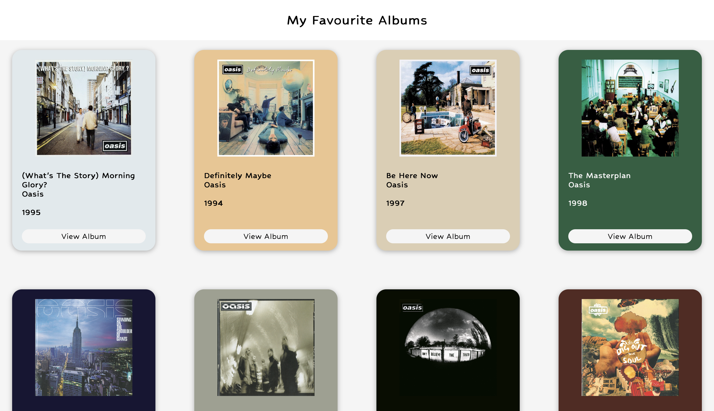
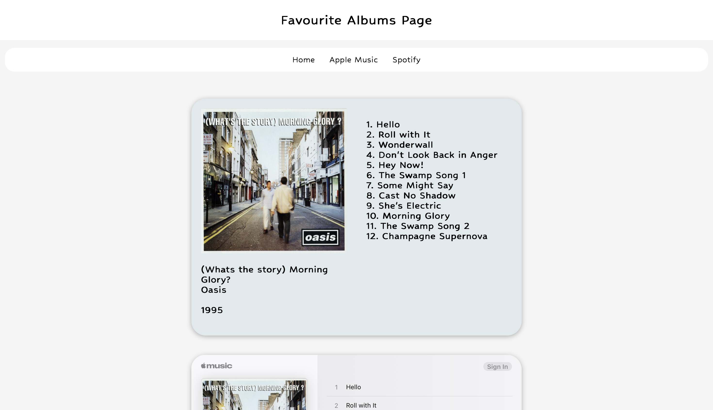

# My Favourite Albums

## Project Overview
I created this project to improve my web development skills and to create something which reflects my interests. It displays all my favourite albums and allows users to:
- Display the album artwork

- View the track list

- Listen to a preview of the album

- Go to the album on Apple Music or Spotify

## Screenshots



## Tech Stack
- HTML

- CSS

## File Structure
```text
  My-Favourite-Albums/
  ┣━ assets/
  ┃  ┣━ fonts/
  ┃  ┣━ icons/
  ┃  ┣━ images/
  ┃  ┗━ screenshots/
  ┣━ css/
  ┃   ┣━ index/
  ┃   ┗━ album pages/
  ┣━ documentation/
  ┣━ pages/
  ┣━ index.html
  ┣━ README.md
  ┗━ .gitignore

```

## Installation & Usage
### Clone the Repository
```bash
  git clone https://github.com/mmurphy0/Favourite-Albums-Page.git
```
### Navigate to the project folder
```bash
  cd Favourite-Albums-Page
```

Open the project in your preferred IDE

### Usage
You can choose from the following option
- Open index.html in your web browser

- Install the live server extension on Visual Studio Code

## Documentation
<a href="documentation/designs.pdf">Figma Designs</a><br>
<a href="documentation/sitemap.jpg">Sitemap Diagram</a>

## Future Updates
- Update the style of all album pages
